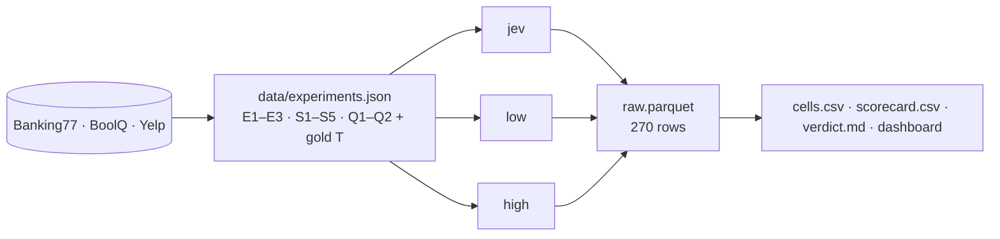

# Jev vs LLM Mini-Benchmark

[](https://github.com/arihan01/jev-vs-llm-benchmark/actions/workflows/ci.yml)


Can a typed decision model replace "LLM + prompt + parser" for classification decisions? This repo asks
TypeSafe's Jev and two LLMs the same questions about the same perturbed inputs. For every call it records
the answer, probabilities, confidence, tokens, latency, cost, and whether the answer matches the gold
answer **T**. The grid is small enough to inspect by hand.

## What this measures

| | |
|---|---|
| Engines | `jev` typesafe/jev-1.13 (Decisions API) · `low` qwen/qwen3.5-9b · `high` gpt-6-sol (OpenAI direct, reasoning off) |
| Experiments | E1 Choice (Banking77) · E2 Noul (BoolQ) · E3 Score (Yelp) |
| Samples | S1–S5 per experiment: typo, paraphrase, padding, distractor, and S5 unaltered as a control |
| Questions | Q1 = the dataset's task with its human label · Q2 = a hand-written second question |
| Repeats | 3 per engine × question, temperature 0 |
| Total | 3 × 5 × 2 × 3 × 3 = **270 calls** |



## Quick start

```bash
make setup               # .venv + package + dev tools (Python 3.11+)
cp .env.example .env     # add OPENROUTER_API_KEY and OPENAI_API_KEY
make experiments-llm     # fill the three S2 paraphrases
# edit data/experiments.json: write Q2 + gold for all 15 samples (see below)
make validate            # readiness check
make dry                 # 270 jobs + cost estimate, no calls
make smoke               # 9 live calls (each engine × experiment on S1Q1)
make bench               # 270 calls, then the report
make dashboard
```

**From the dashboard** (`make dashboard`): the sidebar picks the config; **Config** toggles engines, swaps
models and prices, and edits samples, golds and Q2s in `data/experiments.json` (a Reset button restores a sample from `data/experiments.original.json`, the untouched build written by `make experiments`); **Run** shows which keys are set, runs a
dry estimate or a live run with optional filters, and streams the log. `stat` (TF-IDF + logistic regression
trained on each dataset's train split, local, Q1 only) ships disabled; pick it in the Run page's engine filter
for a one-off run, or enable it on the Config page.

`make help` lists every target. Any target accepts `CONFIG=<file>` to use another config (see
[Free trial](#free-trial)). The CLI is also installed as `jev-bench` (same flags as
`python -m bench.run`), e.g. `jev-bench --exp E1 --engine jev --sample S1 --repeats 1 -v`.

## Free trial

[`config.free.yaml`](config.free.yaml) swaps the engines so you can run the grid without buying
OpenRouter credits. The default `config.yaml` is unchanged.

```bash
make smoke CONFIG=config.free.yaml
make bench CONFIG=config.free.yaml       # or: BENCH_CONFIG=config.free.yaml jev-bench --all
```

| Engine | Model | Route | Key |
|---|---|---|---|
| `jev` | `jev-1.13.0` | TypeSafe direct (`api.typesafe.ai/v1/systemone`); OpenRouter has no free Jev | `TYPESAFE_API_KEY` |
| `low` | `qwen/qwen3.8-27b:free` | OpenRouter, JSON schema on | `OPENROUTER_API_KEY` |
| `high` | `nvidia/nemotron-3-ultra-550b-a55b:free` | OpenRouter, no `response_format` (unsupported); the answer is parsed from plain text | `OPENROUTER_API_KEY` |

- **Daily cap.** OpenRouter allows 20 requests/min and **50/day per account** on `:free` models
  (1,000/day after a one-time $10 purchase). The two free engines need 180 calls, so run `make bench`
  once a day for about 4 days. `make dry CONFIG=config.free.yaml` shows how many calls remain. When the
  cap is hit, that engine's remaining jobs stop with a "re-run tomorrow" message. Those deferred jobs
  are not retried, cached or saved, so they never count as failures. Until the grid is complete,
  `verdict.md` opens with an "Incomplete: N/270 calls done" banner.
- **Reasoning models.** Free reasoning models such as Nemotron Ultra need `reasoning: off`; otherwise
  they spend `max_tokens` thinking and return empty content, and every answer is invalid. `high` sets
  `reasoning: off` and `max_tokens: 400`.
- **Schema fallback.** If a model rejects `response_format` with a 400, the call is resent once without
  it, and the answer is parsed from the text. The `structured_output` column in `raw.parquet` records
  which calls used the schema.
- **Rate limit.** `rpm: 20` and `concurrency: 1` keep the free engines under the per-minute limit.
  Retries wait their turn too. Other engines keep their own settings.
- **Cost.** TypeSafe's response reports tokens but not cost, so cost is computed as tokens × the
  engine's `price_in` / `price_out`. 90 Jev calls is well under $0.01, and may be covered by a TypeSafe
  sign-up credit if one is offered.
- **Kept separate.** Results go to `results/free/`, and the cache is keyed by engine *and* model, so a
  free run never mixes with a `config.yaml` run.
- `high` is a large open model, not a commercial frontier model. The paraphrase generator is also a
  `:free` model and uses 3 of the daily calls.
- Free model ids change often. Confirm them at openrouter.ai/models before running. A schema-capable
  fallback for `high` is `nvidia/nemotron-3-super-120b-a12b:free`.

Per-engine settings (any config): `base_url`, `api_key_env`, `structured_output`, `reasoning`,
`max_tokens`, `concurrency`, `rpm`, `price_in`, `price_out`, `price_cached` (for prompt tokens the provider reports as cached). OpenRouter-only request fields (`usage`, `reasoning`) are sent only to
OpenRouter.

## Writing Q2

Each sample's second question sits next to Q1 in `data/experiments.json`:

```json
{"id": "Q2", "type": "score", "instructions": "How likely is the reviewer to return?",
 "options": {"0": "Will not return", "1": "Might return", "2": "Will certainly return"}, "gold": "2"}
```

- `type` must match the experiment (choice / noul / score).
- Noul options are exactly `yes` / `no`. Score options are keyed `0..n-1` in increasing order (2–10 levels).
- `gold` is one of the option keys. Write the Q2s before you see any engine output.

`make bench` refuses to start while any gold is `null`, any `TODO` text remains, or a paraphrase is still
pending. `make experiments` never overwrites the file; `make experiments FORCE=1` rebuilds it and throws
away the Q2s.

## How it works

The full pipeline diagram and the `EiSjQp × engine × repeat` index scheme are in
[docs/experiment.md](docs/experiment.md). What is sent to each engine, what comes back and how it is parsed and scored, as one diagram: [docs/dataflow.md](docs/dataflow.md).

- **Same words**: Jev gets `instructions` + option text as fields; the LLMs get the same strings in the
  fixed template below (checked in `tests/test_prompts.py`). No few-shot examples.
- **Same input and gateway**: identical perturbed text, and every engine is called through one
  OpenRouter key.
- **LLMs mimic Jev's output**: a JSON schema with the label as an enum plus a 0–1 confidence. Qwen's
  reasoning is turned off. Unparseable or out-of-set answers count as wrong and are logged as invalid.

```
System: You are a classifier. Reply only with JSON matching the schema.
User:
{instructions}
Options:
{key: description lines}
Input:
{state}
Return {"label": <one option key>, "confidence": <0-1>}.
```

## Outputs

| File | Contents |
|---|---|
| `results/raw.parquet` | one row per attempted call: exp, sample, question, perturbation, engine, repeat, gold, label, value, probs, confidence, correct, valid, structured_output, latency, tokens, cost, status, error |
| `results/cells.csv` | one row per `EiSjQp × engine`: the 3 answers, majority-correct, consistent, mean latency / tokens / cost, P(gold) mean and std, MAE or Brier |
| `results/scorecard.csv` | experiment × engine: expected / attempted / answered / deferred calls, accuracy, consistency, invalid and error rate, p50/p95 latency, total tokens and cost, cost per 100 questions, Noul AUROC / Brier, Score MAE |
| `results/verdict.md` | per primitive: which engine, latency, tokens, cost, error rate, caveats |
| `results/report.md` | `make export`: the write-up in six sections: the experiment, what is measured, the inputs with examples and their T, the run report (headline numbers, ✓/✗ grid, what stands out, speed, tokens, accuracy by change), source excerpts of the core code, and observations. Cost columns are omitted when any engine is free-tier. Observations are stage 2: write `observations.md` next to the report (by hand or in an LLM session) and re-export to include it. Aggregates only, no charts |
| `results/report.pdf` | `make export PDF=1`: the same report as a landscape PDF with wrapped tables; needs `pip install -e '.[pdf]'` (WeasyPrint; on macOS also `brew install pango`) |

The dashboard shows a correctness grid per experiment (engines × `S1Q1…S5Q2`, one ✓/✗ per repeat), a
latency box plot, tokens and cost, consistency, and accuracy by perturbation.

`results/` is gitignored apart from `.gitkeep`. To commit a snapshot for a demo, add it with
`git add -f results/...`.

## Development

```bash
make check               # ruff lint + format check, mypy, pytest with an 85% coverage gate
make fmt                 # apply ruff fixes and formatting
make precommit-install   # run the same checks on every commit
```

CI (`.github/workflows/ci.yml`) runs `make check`'s commands on Python 3.11, 3.12 and 3.14. It needs no
key and makes no network calls.

**Offline fake gateway.** `tests/conftest.py` replaces `Adapter.call` with a deterministic fake that
returns responses shaped like the real Jev and chat-completion responses. That lets the full 270-call
pipeline, cache-only reproducibility, the `gold: null` guard and failure handling all run in about a
second. HTTP retry behaviour is tested separately with `respx` in `tests/test_adapters_http.py`.

**Adding an engine or a perturbation**: see [docs/experiment.md](docs/experiment.md#extending).
Contribution notes: [CONTRIBUTING.md](CONTRIBUTING.md). Changes: [CHANGELOG.md](CHANGELOG.md).

```
bench/
  config.py            config selection (--config / BENCH_CONFIG), per-engine URL + key, logging
  data.py              sample + freeze data/{task}.jsonl (300 per task, seed 42)
  prompts.py           question rendering for Jev and the LLM template
  perturb.py           typo / padding / distractor / paraphrase
  build_experiments.py data/experiments.json builder + readiness checks
  adapters/            base.py (HTTP, retries, timing), jev.py (Decisions API), llm.py (chat + JSON schema)
  cache.py runner.py   cached async calls -> results/raw.parquet
  metrics.py report.py cells, scorecard, verdict
  run.py               CLI (jev-bench)
dashboard/             streamlit app + plotly figures
scripts/               smoke.py, demo.py, gen_banking77_descriptions.py
tests/                 offline unit + pipeline tests
```

## Reproducibility and cost

- Data is frozen in `data/`: 300 items per task (stratified, seed 42) and `experiments.json`. Banking77
  comes from PolyAI's canonical CSV, because the Hub repo is a loading script that current `datasets`
  no longer runs.
- Every response is written to `.cache/` before it is scored. Re-running `make bench` makes no calls and
  reproduces the same scorecard, and partial runs merge into one table.
- `make dry` estimates cost from prompt length and the `price_in` / `price_out` values in
  `config.yaml`. The real cost comes from each response's `usage.cost`. OpenAI reports no cost, so
  `high`'s cost is tokens × its `price_in` / `price_out`; set those from openai.com/api/pricing.

## Troubleshooting

| Symptom | Fix |
|---|---|
| `OPENROUTER_API_KEY is not set` | `cp .env.example .env` and add the key from openrouter.ai/settings/keys |
| `TYPESAFE_API_KEY is not set` | only needed for `config.free.yaml`; get it at console.typesafe.ai/settings/keys |
| `daily request limit reached … re-run tomorrow` | the `:free` cap is used up; re-run tomorrow, and finished calls stay cached |
| every `high` row says `empty content (finish_reason=length …)` | a reasoning model is thinking; set `reasoning: off` (and raise `max_tokens`) for that engine |
| `data/experiments.json is not ready` | run `make validate` and fix each listed item; usually Q2s or `make experiments-llm` |
| many 429s / slow runs | lower `concurrency` in `config.yaml`; retries back off automatically and are counted in `retries_429` |
| Jev rows all invalid with `no answer in response` | the alpha API's response shape changed; run `make smoke`, inspect the raw JSON, adjust `find_answer` in `bench/adapters/jev.py` |
| Hugging Face download errors on `make data` | set `HF_TOKEN` in `.env` (see `.env.example`) |
| a run was interrupted | just re-run; finished calls are served from `.cache/` |

## Caveats

- Quality metrics (accuracy, consistency, invalid rate, latency) use only calls that got an HTTP 200.
  Transport and provider errors are reported as `error_rate`. An unparseable or out-of-set answer is
  still a 200 and counts as wrong.
- LLM confidence is self-reported, not a probability; Jev's is a probability. Read calibration numbers
  with that in mind.
- Jev's run-to-run variance shows up in the `consistent` column and is reported, not hidden.
- 30 calls per engine per experiment: a difference of one or two answers is noise.
- Q2s and their gold answers are hand-written, while Q1 uses the dataset's human label.
