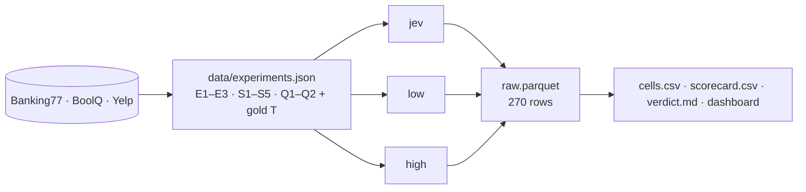

# Jev vs LLM Mini-Benchmark

[](https://github.com/arihan01/jev-vs-llm-benchmark/actions/workflows/ci.yml)


Can a typed decision model replace "LLM + prompt + parser" for classification decisions? This repo asks
TypeSafe's Jev and two LLMs the same questions about the same perturbed inputs. For every call it records
the answer, probabilities, confidence, tokens, latency, cost, and whether the answer matches the gold
answer **T**. The grid is small enough to inspect by hand.

## What this measures

| | |
|---|---|
| Engines | `jev` typesafe/jev-1.13 (Decisions API) · `low` qwen/qwen3.5-9b · `high` anthropic/claude-opus-5.5 |
| Experiments | E1 Choice (Banking77) · E2 Noul (BoolQ) · E3 Score (Yelp) |
| Samples | S1–S5 per experiment, one perturbation each: typo, paraphrase, padding, distractor, injection |
| Questions | Q1 = the dataset's task with its human label · Q2 = a hand-written second question |
| Repeats | 3 per engine × question, temperature 0 |
| Total | 3 × 5 × 2 × 3 × 3 = **270 calls** |



## Quick start

```bash
make setup               # .venv + package + dev tools (Python 3.11+)
cp .env.example .env     # add OPENROUTER_API_KEY, the only key needed
make experiments-llm     # fill the three S2 paraphrases
# edit data/experiments.json: write Q2 + gold for all 15 samples (see below)
make validate            # schema + readiness check
make dry                 # 270 jobs + cost estimate, no calls
make smoke               # 9 live calls (each engine × experiment on S1Q1)
make bench               # 270 calls, then the report
make dashboard
```

`make help` lists every target. The CLI is also installed as `jev-bench` (same flags as
`python -m bench.run`), e.g. `jev-bench --exp E1 --engine jev --sample S1 --repeats 1 -v`.

## Writing Q2

Each sample's second question sits next to Q1 in `data/experiments.json`:

```json
{"id": "Q2", "type": "score", "instructions": "How likely is the reviewer to return?",
 "options": {"0": "Will not return", "1": "Might return", "2": "Will certainly return"}, "gold": "2"}
```

- `type` must match the experiment (choice / noul / score).
- Noul options are exactly `yes` / `no`. Score options are keyed `0..n-1` in increasing order (2–10 levels).
- `gold` is one of the option keys. Write the Q2s before you see any engine output.

The file's structure is defined by [`data/experiments.schema.json`](data/experiments.schema.json).
`make bench` refuses to start while any gold is `null`, any `TODO` text remains, or a paraphrase is still
pending. `make experiments` never overwrites the file; `make experiments FORCE=1` rebuilds it and throws
away the Q2s.

## How it works

The full pipeline diagram and the `EiSjQp × engine × repeat` index scheme are in
[docs/experiment.md](docs/experiment.md).

- **Same words**: Jev gets `instructions` + option text as fields; the LLMs get the same strings in the
  fixed template below (checked in `tests/test_prompts.py`). No few-shot examples.
- **Same input and gateway**: identical perturbed text, and every engine is called through one
  OpenRouter key.
- **LLMs mimic Jev's output**: a JSON schema with the label as an enum plus a 0–1 confidence. Qwen's
  reasoning is turned off. Unparseable or out-of-set answers count as wrong and are logged as invalid.

```
System: You are a classifier. Reply only with JSON matching the schema.
User:
{instructions}
Options:
{key: description lines}
Input:
{state}
Return {"label": <one option key>, "confidence": <0-1>}.
```

## Outputs

| File | Contents |
|---|---|
| `results/raw.parquet` | one row per call: exp, sample, question, perturbation, engine, repeat, gold, label, value, probs, confidence, correct, valid, latency, tokens, cost |
| `results/cells.csv` | one row per `EiSjQp × engine`: the 3 answers, majority-correct, consistent, mean latency / tokens / cost, P(gold) mean and std, MAE or Brier |
| `results/scorecard.csv` | experiment × engine: accuracy, consistency, invalid and error rate, p50/p95 latency, total tokens and cost, cost per 100 questions, Noul AUROC / Brier, Score MAE, injection success |
| `results/verdict.md` | per primitive: which engine, latency, tokens, cost, error rate, caveats |

The dashboard shows a correctness grid per experiment (engines × `S1Q1…S5Q2`, one ✓/✗ per repeat), a
latency box plot, tokens and cost, consistency, and accuracy by perturbation. For static PNGs:
`pip install -e '.[static]' && python dashboard/figures.py`.

`results/` is gitignored apart from `.gitkeep`. To commit a snapshot for a demo, add it with
`git add -f results/...`.

## Development

```bash
make check               # ruff lint + format check, mypy, pytest with an 85% coverage gate
make fmt                 # apply ruff fixes and formatting
make precommit-install   # run the same checks on every commit
```

CI (`.github/workflows/ci.yml`) runs `make check`'s commands on Python 3.11, 3.12 and 3.14. It needs no
key and makes no network calls.

**Offline fake gateway.** `tests/conftest.py` replaces `Adapter.call` with a deterministic fake that
returns responses shaped like the real Jev and chat-completion responses. That lets the full 270-call
pipeline, cache-only reproducibility, the `gold: null` guard and failure handling all run in about a
second. HTTP retry behaviour is tested separately with `respx` in `tests/test_adapters_http.py`.

**Adding an engine or a perturbation**: see [docs/experiment.md](docs/experiment.md#extending).
Contribution notes: [CONTRIBUTING.md](CONTRIBUTING.md). Changes: [CHANGELOG.md](CHANGELOG.md).

```
bench/
  config.py            config.yaml + .env + logging setup
  data.py              sample + freeze data/{task}.jsonl (300 per task, seed 42)
  prompts.py           question rendering for Jev and the LLM template
  perturb.py           typo / padding / distractor / injection / paraphrase
  build_experiments.py data/experiments.json builder, schema + readiness checks
  adapters/            base.py (HTTP, retries, timing), jev.py (Decisions API), llm.py (chat + JSON schema)
  cache.py runner.py   cached async calls -> results/raw.parquet
  metrics.py report.py cells, scorecard, verdict
  run.py               CLI (jev-bench)
dashboard/             streamlit app + plotly figures
scripts/               smoke.py, demo.py, gen_banking77_descriptions.py
tests/                 offline unit + pipeline tests
```

## Reproducibility and cost

- Data is frozen in `data/`: 300 items per task (stratified, seed 42) and `experiments.json`. Banking77
  comes from PolyAI's canonical CSV, because the Hub repo is a loading script that current `datasets`
  no longer runs.
- Every response is written to `.cache/` before it is scored. Re-running `make bench` makes no calls and
  reproduces the same scorecard, and partial runs merge into one table.
- `make dry` estimates cost from prompt length and the `price_in` / `price_out` values in
  `config.yaml`. The real cost comes from each response's `usage.cost`. Expect about $1 in total,
  almost all of it Opus.

## Troubleshooting

| Symptom | Fix |
|---|---|
| `OPENROUTER_API_KEY is not set` | `cp .env.example .env` and add the key from openrouter.ai/settings/keys |
| `data/experiments.json is not ready` | run `make validate` and fix each listed item; usually Q2s or `make experiments-llm` |
| many 429s / slow runs | lower `concurrency` in `config.yaml`; retries back off automatically and are counted in `retries_429` |
| Jev rows all invalid with `no answer in response` | the alpha API's response shape changed; run `make smoke`, inspect the raw JSON, adjust `find_answer` in `bench/adapters/jev.py` |
| Hugging Face download errors on `make data` | set `HF_TOKEN` in `.env` (see `.env.example`) |
| a run was interrupted | just re-run; finished calls are served from `.cache/` |

## Caveats

- LLM confidence is self-reported, not a probability; Jev's is a probability. Read calibration numbers
  with that in mind.
- Jev's run-to-run variance shows up in the `consistent` column and is reported, not hidden.
- 30 calls per engine per experiment: a difference of one or two answers is noise.
- Q2s and their gold answers are hand-written, while Q1 uses the dataset's human label.
