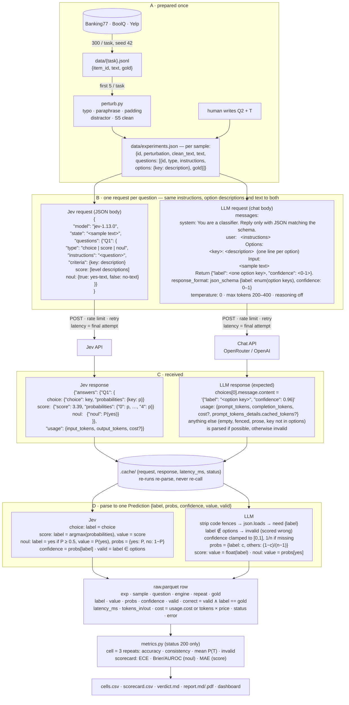

# Data flow

What is sent to each engine, how it is built, what comes back and how it is scored. One call = one text, one question, one engine, one repeat.

Paraphrase is written by a generator model that is not under test; its output is frozen in `experiments.json` like every other sample.

Both engines see the same three strings: the question's instructions, every option's description, and the sample text. Jev gets them as fields, the LLM as one prompt plus a JSON schema. For BoolQ the `{passage, question}` object goes to Jev as JSON and to the LLM as JSON text inside the prompt.
