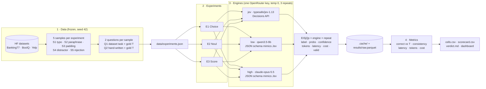
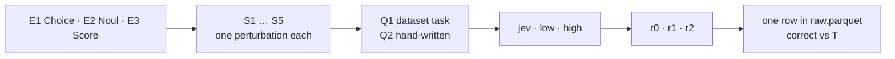

# Experiment design

## Pipeline

## Index scheme

Every call is addressed as `EiSjQp × engine × repeat`, e.g. `E2S4Q1 · low · r2`.
3 × 5 × 2 × 3 × 3 = **270 calls**.

## Extending

### Adding an engine

1. Add it under `engines:` in `config.yaml` with `kind` (`jev` or `llm`), `model`, and `price_in` /
   `price_out` for the dry-run estimate. Any chat model on OpenRouter that supports JSON-schema output
   works as `kind: llm` with no code changes.
2. For a different API shape, subclass `bench.adapters.base.Adapter`: implement
   `build_request(q, text, temperature)` and `parse(q, response) -> Prediction`, then route to it in
   `bench/adapters/__init__.py::make`. HTTP, retries and timing come from the base class.
3. Add the engine's colour to `COLORS` in `dashboard/figures.py` and a parsing test next to
   `tests/test_jev_adapter.py`.

### Adding a perturbation

1. Write the transformation in `bench/perturb.py`. It must keep the gold answer unchanged and be
   deterministic given the `random.Random` it receives.
2. Add a branch for it in `bench/build_experiments.py::build_sample`, and use it in `sample_perturbations` in `config.yaml`.
3. Rebuild with `make experiments FORCE=1`. This throws away the hand-written Q2s, so copy them out
   first.
